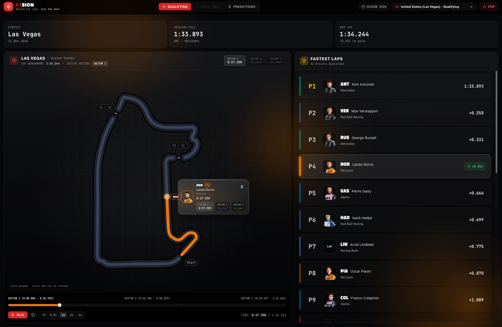
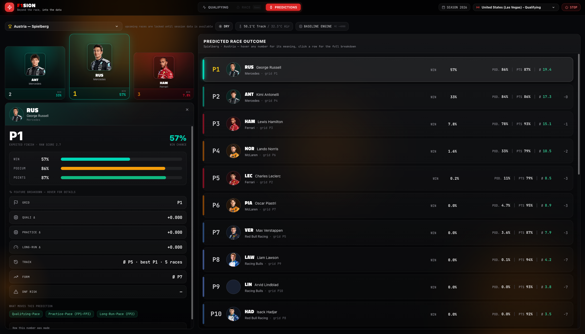
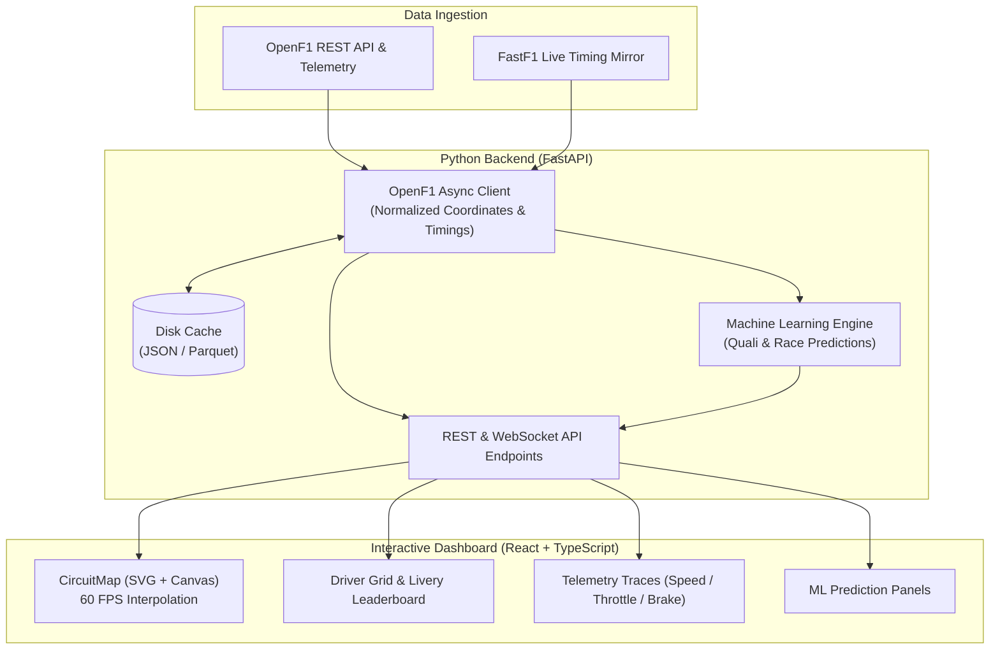

# F1SION

[](https://python.org)
[](https://fastapi.tiangolo.com)
[](https://react.dev)
[](https://www.typescriptlang.org)
[](https://tailwindcss.com)
[](https://opensource.org/licenses/MIT)

**Beyond the race, into the data.**

An F1 analytics, prediction and simulation platform. F1SION combines session data, an interactive circuit, and (coming next) machine learning models for qualifying and race outcomes.

---

## 🏁 Showcase

**Qualifying Analysis** — live track animation with real-time lap playback, sector split timing and the full grid lineup:



**Race Predictions** — Monte-Carlo simulated race outcome with predicted podium, per-driver win/podium/points probabilities and a full feature breakdown:



<details>
<summary>📦 More screenshots</summary>
soon™
</details>

---

## 🎨 Fonts

The app ships with the bundled open substitute **Titillium Web** (SIL Open Font License, the classic F1 web font) — no setup required. The woff2 files live in `frontend/public/fonts/` together with the license (`LICENSE-TitilliumWeb.txt`).

**Optional:** To use the authentic Formula 1 typeface for driver acronyms, drop the font files into `frontend/public/fonts/` (they take priority over Titillium automatically):

- `Formula1-Regular.ttf`
- `Formula1-Bold.ttf` (also used for the display/bold and wide cuts)
- `Formula1-Wide.ttf`
- `Formula1-Black.ttf`

**Important:** The Formula 1 typeface is **proprietary** and not openly licensed.

- For **personal, non-commercial use**: Place the files locally; they are **excluded from version control** via `.gitignore`.
- For **public repositories / commercial use**: Keep the Titillium substitution or use another open-source alternative.

---

## 📜 License

This project is licensed under the **MIT License** - see the [LICENSE](LICENSE) file for details.

---

## 🏛️ System Architecture



---

## 🚀 Quick Start

### Prerequisites
- **Python 3.12+**
- **Node.js 18+** & `npm`

### 1. Run Development Servers
You can start both the FastAPI backend and Vite frontend simultaneously:

```bash
./run_dev.sh
```

Or start them individually:

#### Backend
```bash
cd backend
python3 -m venv .venv
source .venv/bin/activate
pip install -r requirements.txt
uvicorn app.main:app --reload --port 8000
```
* **Interactive API Documentation (Swagger):** [http://127.0.0.1:8000/docs](http://127.0.0.1:8000/docs)

#### Frontend
```bash
cd frontend
npm install
npm run dev
```
* **Dashboard UI:** [http://localhost:5173](http://localhost:5173)

---

## 📁 Repository Structure

```text
f1sion/
├── backend/
│   ├── app/
│   │   ├── api/             # FastAPI REST route definitions
│   │   ├── core/            # Configuration and caching utilities
│   │   ├── data/            # OpenF1 & telemetry extraction client
│   │   ├── ml/              # Model training, feature pipelines & inference
│   │   ├── models/          # Pydantic schemas and data contracts
│   │   └── main.py          # ASGI application entrypoint
│   ├── cache/               # Local cache for instant (<10ms) responses
│   ├── scripts/             # Data exploration & model validation scripts
│   └── requirements.txt     # Python dependencies
│
├── frontend/
│   ├── public/
│   │   └── fonts/           # Titillium Web substitute + optional Formula 1 fonts
│   ├── src/
│   │   ├── components/      # CircuitMap, Leaderboard, Header, ErrorBoundary
│   │   ├── services/        # Typed API clients
│   │   ├── types/           # TypeScript data interfaces
│   │   ├── App.tsx          # Main dashboard container
│   │   └── main.tsx         # React root
│   ├── package.json
│   ├── tailwind.config.js   # Custom F1 dark-mode theme
│   └── vite.config.ts       # Reverse proxy configuration
│
├── run_dev.sh               # One-click dual-server launcher
└── README.md
```

---

## 🛠️ Roadmap & Features
- [x] Phase 1: Environment setup & OpenF1 caching client
- [x] Phase 2: FastAPI endpoints with Pydantic contract validation
- [x] Phase 3: Interactive SVG circuit geometry rendering with real-time car animation
- [ ] Phase 4: Machine Learning baseline model (Qualifying & Race result predictions)
- [ ] Phase 5: Telemetry comparison curves (Throttle, Brake, Speed delta)
- [ ] Phase 6: Tire degradation & pit window strategy simulator
