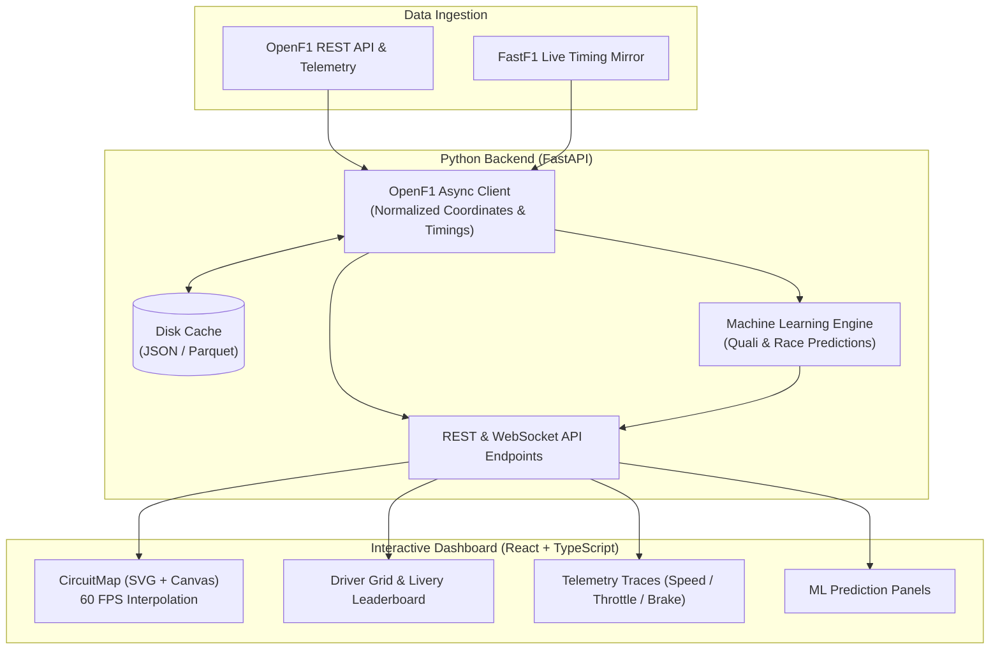

# F1SION

[](https://python.org)
[](https://fastapi.tiangolo.com)
[](https://react.dev)
[](https://www.typescriptlang.org)
[](https://tailwindcss.com)

**Beyond the race. Into the data.**

An F1 analytics, prediction and simulation platform. F1SION combines session data, an interactive circuit, and (coming next) machine learning models for qualifying and race outcomes.

Driver acronyms on the circuit and the grid use the Formula 1 display face in `frontend/public/fonts`. That typeface is not openly licensed — fine for a personal, non-commercial project, not for a product you ship or sell.

---

## 🏛️ System Architecture



---

## 🚀 Quick Start

### Prerequisites
- **Python 3.12+**
- **Node.js 18+** & `npm`

### 1. Run Development Servers
You can start both the FastAPI backend and Vite frontend simultaneously:

```bash
./run_dev.sh
```

Or start them individually:

#### Backend
```bash
cd backend
python3 -m venv .venv
source .venv/bin/activate
pip install -r requirements.txt
uvicorn app.main:app --reload --port 8000
```
* **Interactive API Documentation (Swagger):** [http://127.0.0.1:8000/docs](http://127.0.0.1:8000/docs)

#### Frontend
```bash
cd frontend
npm install
npm run dev
```
* **Dashboard UI:** [http://localhost:5173](http://localhost:5173)

---

## 📁 Repository Structure

```text
f1sion/
├── backend/
│   ├── app/
│   │   ├── api/             # FastAPI REST route definitions
│   │   ├── core/            # Configuration and caching utilities
│   │   ├── data/            # OpenF1 & telemetry extraction client
│   │   ├── ml/              # Model training, feature pipelines & inference
│   │   ├── models/          # Pydantic schemas and data contracts
│   │   └── main.py          # ASGI application entrypoint
│   ├── cache/               # Local cache for instant (<10ms) responses
│   ├── scripts/             # Data exploration & model validation scripts
│   └── requirements.txt     # Python dependencies
│
├── frontend/
│   ├── src/
│   │   ├── components/      # CircuitMap, Leaderboard, Header, Widgets
│   │   ├── services/        # Typed API clients
│   │   ├── types/           # TypeScript data interfaces
│   │   ├── App.tsx          # Main dashboard container
│   │   └── main.tsx         # React root
│   ├── package.json
│   ├── tailwind.config.js   # Custom F1 dark-mode theme
│   └── vite.config.ts       # Reverse proxy configuration
│
├── run_dev.sh               # One-click dual-server launcher
└── README.md
```

---

## 🛠️ Roadmap & Features
- [x] Phase 1: Environment setup & OpenF1 caching client
- [x] Phase 2: FastAPI endpoints with Pydantic contract validation
- [x] Phase 3: Interactive SVG circuit geometry rendering with real-time car animation
- [ ] Phase 4: Machine Learning baseline model (Qualifying & Race result predictions)
- [ ] Phase 5: Telemetry comparison curves (Throttle, Brake, Speed delta)
- [ ] Phase 6: Tire degradation & pit window strategy simulator
